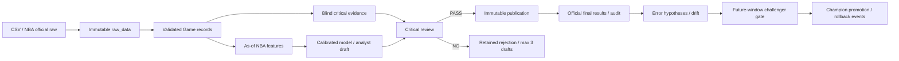

# Sporton 설계 · 저장 무결성 기반 v0.3

## 목표와 구현 경계

보지 못한 경기의 예측을 평가하고 원본·실패·모델 교체 근거를 보존한다. NBA·축구·야구에 별도의 통계 분석기와 데이터 계약·모델·심사 규칙을 둔다. 모델은 종목뿐 아니라 리그별로 분리한다. 실제 데이터가 없으면 실전 성능과 확률 우위를 주장하지 않는다. 빈 저장소에서 시작했으며 기존 코드는 없었다.

모듈 | 책임 | 인터페이스
---|---|---
A `data.py`, `contracts.py` | 소스 어댑터, 원본 보존, 정규화·시점 검증 | `DataSourceAdapter.collect() -> list[Game]`, `ingest()`
B `NBAAnalyst`, `FootballAnalyst`, `BaseballAnalyst` | 종목별 피처와 설명 규칙에 따른 보고서 | `draft(fixture, snapshot, artifact, metadata, evidence_id)`
C `features.py`, `models.py`, `sports/*` | 피처, 학습, 교정, 시계열 평가, 레지스트리 | `snapshot`, `train`, `walk_forward`, `promote`, `rollback`
D `NBACriticalAnalyst`, `IndependentSportReviewer` | 초안에 앞선 별도 근거와 비판·게시 심사 | `blind_assessment`, `review -> PASS/NO`
E `engine.audit`, `maintenance.py` | 실제 결과 감사, 가설, 드리프트, 후보 재학습 | `audit`, `daily`, `tick`
F `cli.py`, `api.py`, `dashboard.html` | 실행 제어와 읽기 전용 대시보드 | CLI, HTTP GET API

분석기는 규칙·통계 모델 기반이다. 생성형 LLM을 연결한 제품이라고 부르지 않는다. 심사기는 예측 방향을 보기 전에 원시 경기 데이터의 별도 최근 마진 근거를 저장하고 초안과 비교한다. 다른 LLM 역할 이름을 붙인 구조가 아니다. 완전한 독립 예측 모델이나 외부 전문 분석가 심사와 동등하다는 주장은 하지 않는다.

## 데이터 흐름

## 저장과 권한

PostgreSQL을 운영 저장 경로로 사용하고 SQLite WAL은 기존 자료·독립 테스트 호환 경로로 유지한다. 46개 원본 이벤트 테이블은 ID, 기록 시각, canonical JSON payload, SHA256을 가진 append-only 구조다. FK를 갖는 보고서·관측 인덱스와 농구·야구·축구·배구·e스포츠의 독립 통계 테이블을 더해 총 53개다. 종목별 상세 열이 생겼지만 해당 공급자 자료가 모두 수집되거나 모델에 연결된 것은 아니다. [저장 구조와 실행 절차](persistence.md)에 구현 경계를 기록했다.

DB UPDATE/DELETE/TRUNCATE 차단과 조회 시 해시 검증으로 원본을 보호한다. PostgreSQL 앱 역할은 SELECT/INSERT만 갖고 스키마·백업·복원 역할과 분리한다. PRE_GAME 게시에는 DB 서버 시각·정정된 시작 시각·원본 예측/피처/모델/사전 심사 일치 검사도 적용한다. 정정은 이유·변경자·시각·증거를 갖는 새 이벤트이며 과거 cutoff에는 미래 정정이 노출되지 않는다. 모델 파일은 체크섬을 확인한 뒤 로드하며 joblib은 신뢰된 로컬 학습 산출물만 허용한다. 최상위 DB 관리자/파일 시스템 권한자를 막는 WORM 보장은 아니다.

웹은 조회만 제공한다. 별도 관리자 API는 파일 기반 Bearer 인증을 요구하며 보고서에서 원본·사용 자료·시장·심사·결과·정정 평가까지 추적한다. 운영 HTTPS·인증 서비스·멀티테넌시와 공개 배포는 검증되지 않았다. 학습·게시·승격은 명시적 CLI 또는 설정된 worker를 거친다. 동일 경기 게시 1회, 반려 초안 최대 3회이며 결과 이후 최초 예측을 수정하지 않는다. NO를 억지로 PASS로 만드는 반복 프롬프트는 없다.

## 확장 결정

`sports.plugin(league)`는 FootballPlugin/BaseballPlugin을 반환하고 NBA는 기존 독립 엔진으로 라우팅한다. 공통 lifecycle은 시간 분할·저장·감사만 공유하며 실제 피처·모델 fit/predict·분석 설명·심사 항목은 각 모듈에 있다. KBL·배구·e스포츠는 아직 실행하지 않는다. Champion·승격·rollback 이벤트는 리그별로 조회·관리하며 타 리그 모델을 대신 사용할 수 없다. NBA 모델을 재사용하는 fallback은 없다. 실제 PostgreSQL에서 권한·불변 트리거·게시 게이트·암호화 백업/복원 통합 테스트를 실행했다. Parquet는 원본 해시·품질을 보존하는 분석 파일이고 DuckDB는 고정 집계를 검증한다.

## 운영

Python 3.12, 고정 requirements.lock, FastAPI와 자체 HTML 대시보드. `worker`는 사용 권한을 확보한 공급자가 제공하는 정규화 CSV inbox를 주기적으로 읽고 감사한다. 콘텐츠 해시로 재처리를 막는다. 외부 API가 장애이면 허위 데이터로 대체하지 않는다. CLI 오류와 `source_failures`를 기록한다. 같은 작업을 중복 운영하지 않는다. `persistence-worker`는 별도 owner 역할로 암호화 백업·격리 복원·WAL 보관·보존기간을 관리한다. 복원에 실패한 백업을 검증 완료로 표시하지 않는다. 개발 DB와 백업은 현재 동일 호스트에 있으므로 별도 운영 DB·외부 저장소·키 보관 및 실제 PITR 테스트가 필요하다. [복구 절차](backup-recovery.md)를 따른다.

## 다종목 확장 모듈

` sports/contracts.py`는 FootballGame(90분·무승부)과 BaseballGame(이닝·미실시 홈 공격·연장·MLB/KBO 무승부 규칙)을 구분한다. `sports/football.py`는 골 Poisson 분포와 3-way 교정, `sports/baseball.py`는 선발/타선/불펜 사전 context와 득점 모델을 구현한다. `sports/lifecycle.py`는 별도 근거 심사·학습·검증·감사를 연결한다. 구체 계약과 명령은 [multisport.md](multisport.md)에 있다.

## 정기 브리핑

`briefing.py`는 Asia/Seoul 06:30/17:00 예약, 매시간 inbox/감사/조건부 학습, 현재 Champion으로 경기 전 분석, 이전 브리핑 후 변화 비교, Markdown 원본 보존을 묶는다. PostgreSQL 실행에서는 설정된 암호화 백업 작업과 연동하며 SQLite 로컬 백업은 호환 경로다. 브리핑·등록 주제·생성/누락/백업 이벤트는 `briefings`, `briefing_notes`, `briefing_events`의 append-only 테이블에 보존한다. `briefing.scheduler.json`은 런타임 heartbeat일 뿐이며 새 머신의 프로세스 실행을 보장하지 않는다. UI는 실제 lock과 최근 heartbeat를 확인해 실행 상태를 표시한다. [briefings.md](briefings.md)에 운영·데이터 공급자 한계·상시 호스트 요건을 명시했다.
